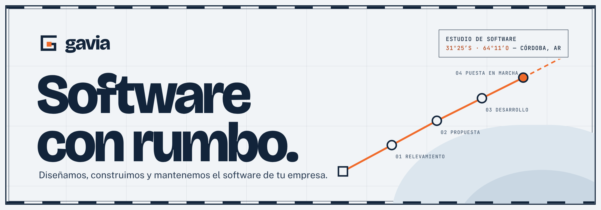
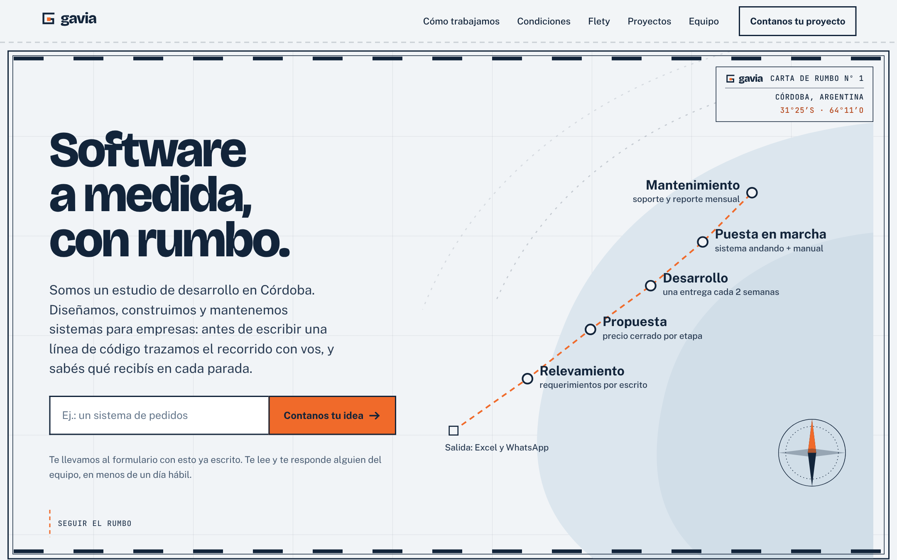
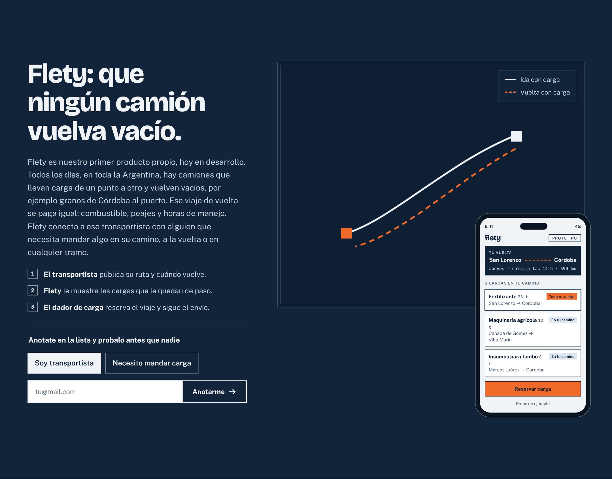

<p align="center">
  
</p>

<p align="center">
  
  
  
  
  
</p>

<p align="center">
  <a href="#qué-es-gavia"><b>Qué es</b></a> ·
  <a href="#arrancar"><b>Arrancar</b></a> ·
  <a href="#cómo-está-armado"><b>Cómo está armado</b></a> ·
  <a href="#la-carta-de-rumbo"><b>Diseño</b></a> ·
  <a href="#antes-de-publicar"><b>Antes de publicar</b></a> ·
  <a href="#tripulación"><b>Tripulación</b></a>
</p>

---

## Qué es Gavia

**Gavia** es un estudio de software de Córdoba, Argentina. Diseñamos, construimos, ponemos en marcha y mantenemos sistemas a medida para pymes y emprendedores, y además armamos productos propios.

Este repositorio es **el sitio web del estudio**: una sola página que se lee como una carta náutica, donde el rumbo va de *"Excel y WhatsApp"* a *"Mantenimiento"*. El objetivo es simple: que el dueño de una pyme lo lea, confíe en el equipo y nos escriba.

> La persona que te escucha es la persona que escribe tu código. Con el proceso formal de una empresa grande, a escala de pyme.

<p align="center">
  
</p>

### El rumbo de un proyecto

Cada etapa termina en algo que el cliente puede leer, probar o firmar.

| | Etapa | Qué te llevás |
|:-:|---|---|
| `01` | **Relevamiento** | Un documento de requerimientos para leer y aprobar. |
| `02` | **Propuesta** | Precio cerrado por etapa, con alcance y plazos. |
| `03` | **Desarrollo** | Una versión para probar cada dos semanas. |
| `04` | **Puesta en marcha** | El sistema andando, tus datos migrados y un manual de uso. |
| `05` | **Mantenimiento** | Un reporte mensual. Opcional. |

### Flety

Nuestro primer producto propio, hoy en desarrollo: una app para que **ningún camión vuelva vacío**. Conecta al transportista que tiene una vuelta sin carga con alguien que necesita mandar algo en ese camino.

<p align="center">
  
</p>

---

## Arrancar

Necesitás **Node.js 20 o superior**.

```bash
git clone https://github.com/Aznar-7/GAVIA.git
cd GAVIA
npm install
npm run dev        # http://localhost:4321
```

| Comando | Qué hace |
|---|---|
| `npm run dev` | Servidor local con recarga en caliente. |
| `npm run build` | Genera el sitio estático en `dist/`. |
| `npm run preview` | Sirve `dist/` para revisarlo antes de publicar. |

El sitio es 100% estático: Vercel lo detecta como proyecto Astro y no necesita configuración extra.

---

## Cómo está armado

```text
GAVIA/
├── public/               favicon, imagen para compartir (og.png), robots.txt
├── src/
│   ├── config.ts         mail, WhatsApp y endpoint de formularios, en un solo lugar
│   ├── layouts/
│   │   └── Base.astro    <head>, SEO, datos estructurados y fuentes
│   ├── components/       una sección del sitio por archivo
│   ├── pages/
│   │   ├── index.astro   la página principal
│   │   ├── og.astro      plantilla de og.png (interna, no se indexa)
│   │   └── logos.astro   exploración de logo (interna, no se indexa)
│   └── styles/
│       └── global.css    tokens de color, tipografía y espaciado
├── PRODUCT.md            a quién le hablamos, qué ofrecemos y qué no prometemos
└── DESIGN.md             el sistema de diseño completo
```

La página principal se lee de arriba abajo en este orden:

`Nav` → `Hero` → `Servicios` → `Ejemplos` → `Proceso` → `Condiciones` → `Flety` → `Proyectos` → `Equipo` → `Preguntas` → `Contacto` → `Footer`

**Stack:** [Astro 5](https://astro.build) · CSS propio con tokens, sin frameworks de UI · [MapLibre GL](https://maplibre.org) + [OpenFreeMap](https://openfreemap.org) para el mapa de Flety (se carga solo cuando la sección se acerca, y si falla queda una carta dibujada) · `@astrojs/sitemap` · fuentes autoalojadas con Fontsource.

---

## La carta de rumbo

Todo el sitio sale de una idea: **una carta náutica de trabajo**. Papel azulado, tinta azul marino y una sola línea de rumbo en naranja. El detalle completo está en [`DESIGN.md`](DESIGN.md); estas son las reglas que no se negocian.

### Dos tintas

| | Token | Hex | Para qué |
|:-:|---|---|---|
|  | `ink` | `#12243a` | Todo lo que se lee y se construye. |
|  | `paper` | `#f1f4f7` | Fondo de página. |
|  | `shoal` | `#dce6ee` | Bajíos: las únicas regiones de color. |
|  | `signal` | `#f06a2a` | El rumbo, los puntos de paso y la acción principal. Nada más. |
|  | `signal-text` | `#b4461a` | Naranja como texto sobre papel (contraste 4.9:1). |

### Tipografía

- **Bricolage Grotesque** para títulos: 800, tracking cerrado.
- **Public Sans** para el texto corrido.
- **JetBrains Mono** solo para lo que la carta *mide*: coordenadas, rumbos, duraciones y versiones.

### Reglas

- **Punteado es plan, continuo es hecho.**
- **Radio cero** en todo. Los únicos círculos son puntos de paso.
- **Sin sombras.** La profundidad es filete, contorno y relleno tonal.
- **Nada se centra.** Título a la izquierda, bajada a la derecha.
- **El estado final siempre es visible.** Toda animación es una mejora y respeta `prefers-reduced-motion`.
- **Sin humo:** ni "soluciones innovadoras", ni emojis, ni testimonios o números inventados.

### La marca


La **G de recorrido**: una G dibujada con un solo trazo, como una ruta o un circuito, que termina en un punto de paso naranja. Sirve sola para cualquier producto futuro.
<br clear="left">

---

## Antes de publicar

Lo que falta configurar está todo en [`src/config.ts`](src/config.ts):

- [ ] **`CONTACT_EMAIL`**: crear la casilla `hola@gaviasoftware.com` (hoy no existe).
- [ ] **`WHATSAPP`**: número en formato internacional sin `+` (ej. `5493511234567`). Vacío = no se muestra.
- [ ] **`FORM_ENDPOINT`**: endpoint que recibe los formularios (por ejemplo, Formspree). Sin endpoint, en desarrollo el envío se simula y en producción abre un mail armado.
- [ ] **Dominio**: registrar `gaviasoftware.com` y apuntarlo a Vercel (ya está en `astro.config.mjs` y `robots.txt`).
- [ ] **`og.png`**: si cambia el mensaje o la marca, abrir `/og` en 1200×630 y capturarla de nuevo en `public/og.png`.

---

## Tripulación

| | Formación | En el barco |
|---|---|---|
| **Vicente Aznar** · [GitHub](https://github.com/Aznar-7) · [Portfolio](https://vicenteaznar.dev) | Ingeniería en Sistemas | Dos años desarrollando sistemas completos, de la base de datos a la pantalla. |
| **Agustín García** | Ingeniería en Sistemas | Analiza cómo trabaja tu empresa y lo baja a requerimientos claros. |
| **Benjamín Viberti** | Ingeniería en Computación | Del hardware al software: sabe cómo funciona la máquina por dentro. |

El nombre viene de **G**arcía · **A**znar · **VI**berti + **IA**. La gavia es la vela alta de un barco: la que se ve primero desde lejos.

<br>

<p align="center">
  <br>
  <b>Software con rumbo.</b><br>
  <sub>Hecho en Córdoba, Argentina.</sub>
</p>
